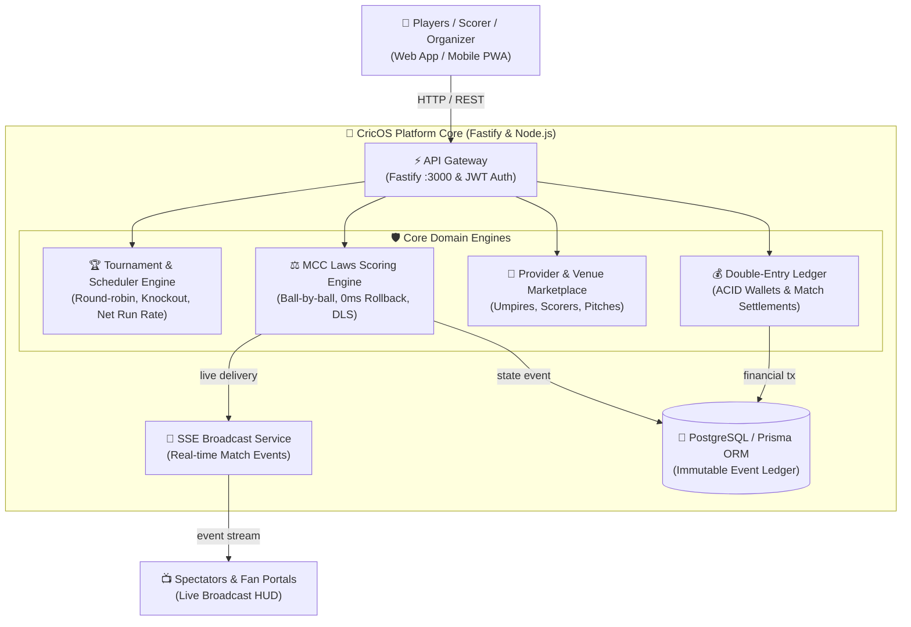
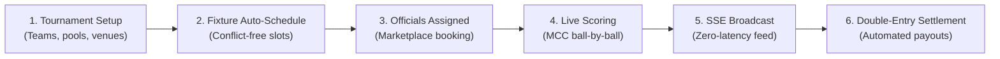
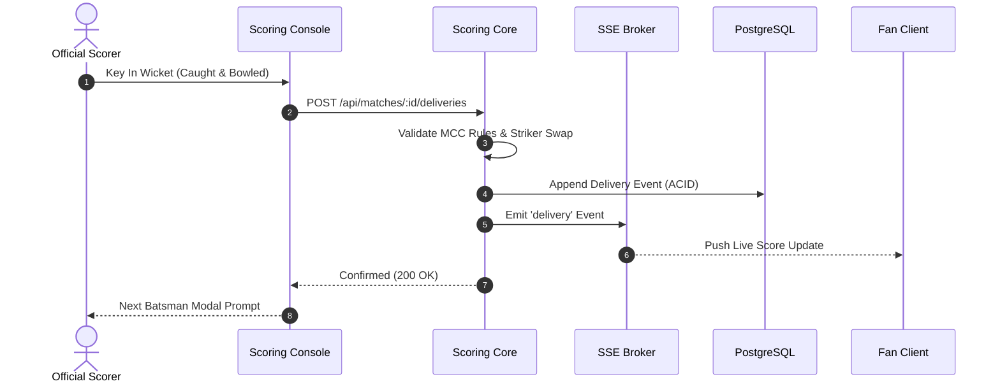
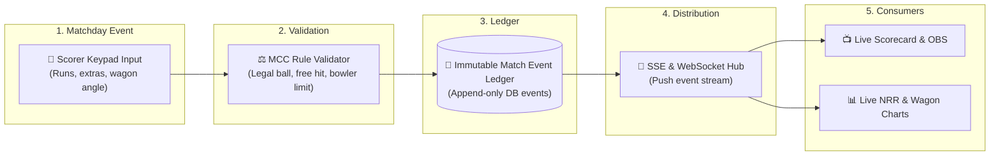
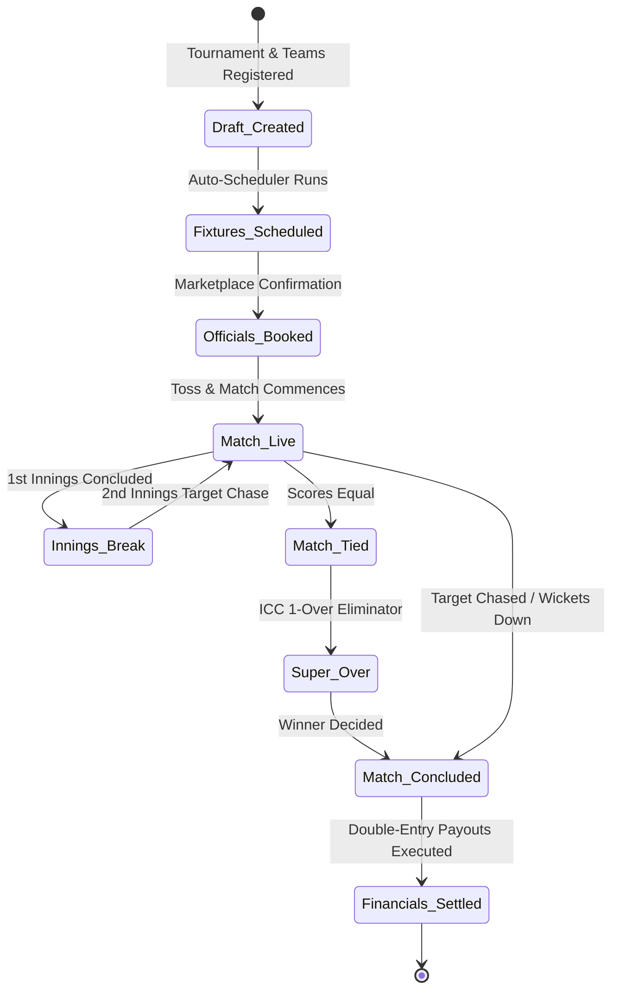

# CricOS — Architecture & System Design

> **Executive Overview**: Unified Cricket Operating System: high-performance tournament scheduling, certified official & venue marketplace, MCC Laws ball-by-ball scoring, real-time Server-Sent Events (SSE) broadcasting, and double-entry financial settlements. Built as a TypeScript monorepo with Fastify, React, and strict domain validation.

All system architectures, tournament workflows, scoring sequences, event pipelines, and match lifecycles are embedded below as native Mermaid diagrams with full architectural explanations.

---

## 🏛️ 1. System Architecture

### Architectural Breakdown & Component Responsibilities
* **Fastify API Gateway**: High-throughput Node.js micro-framework gateway executing route dispatching, JSON schema validation, rate-limiting, and RBAC authentication.
* **Tournament & Scheduler Engine**: Generates tournament fixture grids (round-robin round allocations, double-elimination, seed pairings), manages venue availability matrices, and automatically updates Net Run Rate (NRR) tables according to ICC specifications.
* **MCC Laws Scoring Engine**: Implements the official Marylebone Cricket Club (MCC) Laws of Cricket (Laws 18 to 42), covering dead balls, no ball free hits, byes, leg-byes, bowler over limits, run outs, and penalty runs with instant rollback.
* **Double-Entry Financial Ledger**: Enforces strict financial accounting where every transaction (match fee collection, umpire compensation, ground booking, tournament prize payouts) creates balanced debit and credit entries with immutable audit trails.
* **Server-Sent Events (SSE) Broadcast**: Streams low-latency event payloads (`event: delivery`, `event: wicket`, `event: milestone`) to connected clients and live scoreboards with zero polling overhead.

---

## 🔄 2. Tournament & Match Execution Workflow

---

## ⚡ 3. Ball-by-Ball Scoring & Broadcast Sequence

---

## 🌊 4. Real-time Event Data Flow Pipeline

---

## ⏱️ 5. Match & Tournament Lifecycle

